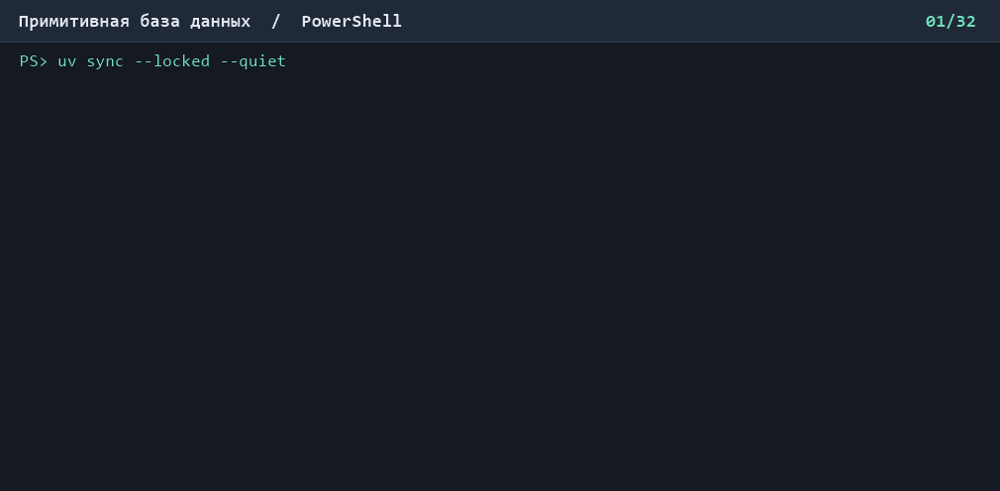

# Примитивная база данных

Учебная консольная база данных на Python. Схемы хранятся в `db_meta.json`, а строки каждой таблицы — в отдельном JSON-файле в папке `data/`. Данные доступны после перезапуска.

## Установка и запуск

Нужны Python 3.12 или новее и `uv`. Выполни из папки проекта:

```powershell
uv sync
uv run database
```

Проверка кода — `uv run ruff check .`.

## Управление таблицами

- `create_table <таблица> <столбец:тип> ...` — создать таблицу. Поддерживаются `int`, `str` и `bool`. Столбец `ID:int` добавляется автоматически.
- `list_tables` — вывести имена сохранённых таблиц.
- `drop_table <таблица>` — удалить таблицу вместе с её строками.
- `help` — показать справку.
- `exit` — завершить работу.

## Работа со строками

- `insert into users values ("Анна", 28, true)` — добавить строку. Значения идут в порядке столбцов, ID выдаётся автоматически.
- `select from users` — показать все строки.
- `select from users where age = 28` — показать строки, удовлетворяющие условию.
- `update users set age = 29 where ID = 1` — обновить подходящие строки.
- `delete from users where ID = 1` — удалить подходящие строки.

Строки указываются в кавычках, логические значения — как `true` или `false`. В `WHERE` условия можно соединять через `AND`. В `SET` несколько полей разделяются запятыми.

Перед `delete` и `drop_table` приложение запрашивает подтверждение. Ввод `y` подтверждает удаление. При ошибке приложение показывает сообщение и снова ждёт команду. `insert` и `select` показывают время выполнения. Повторная выборка использует кэш, пока строки таблицы остаются актуальными.

## Демонстрация

[](demo.cast)

[Скачать запись asciicast](demo.cast)

```text
create_table users name:str age:int active:bool
list_tables
insert into users values ("Анна Иванова", 28, true)
select from users
update users set age = 29 where ID = 1
select from users where age = 29
delete from users where ID = 1
n
delete from users where ID = 1
y
drop_table users
y
list_tables
exit
```
